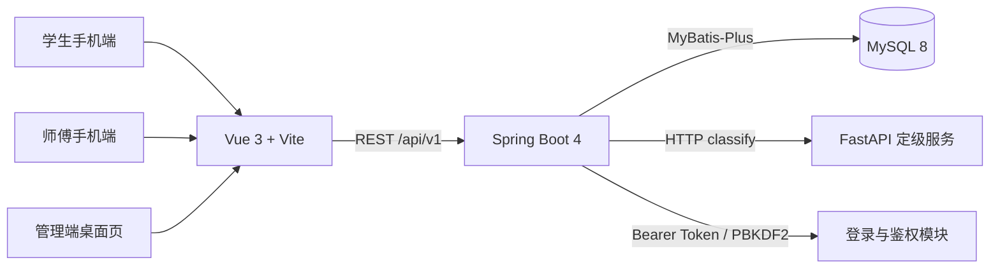
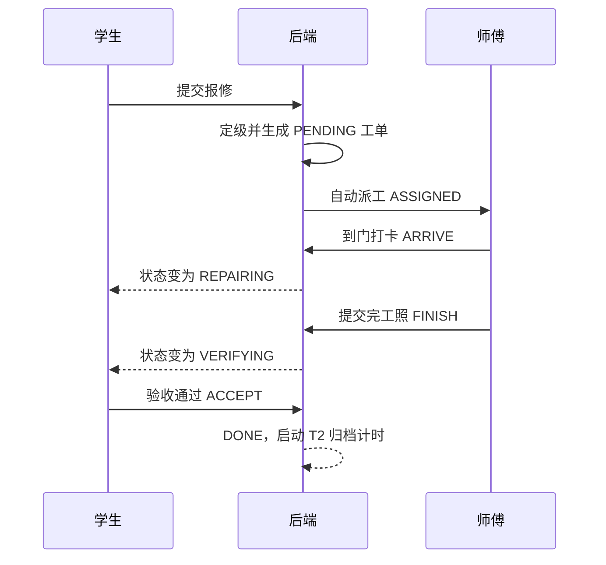
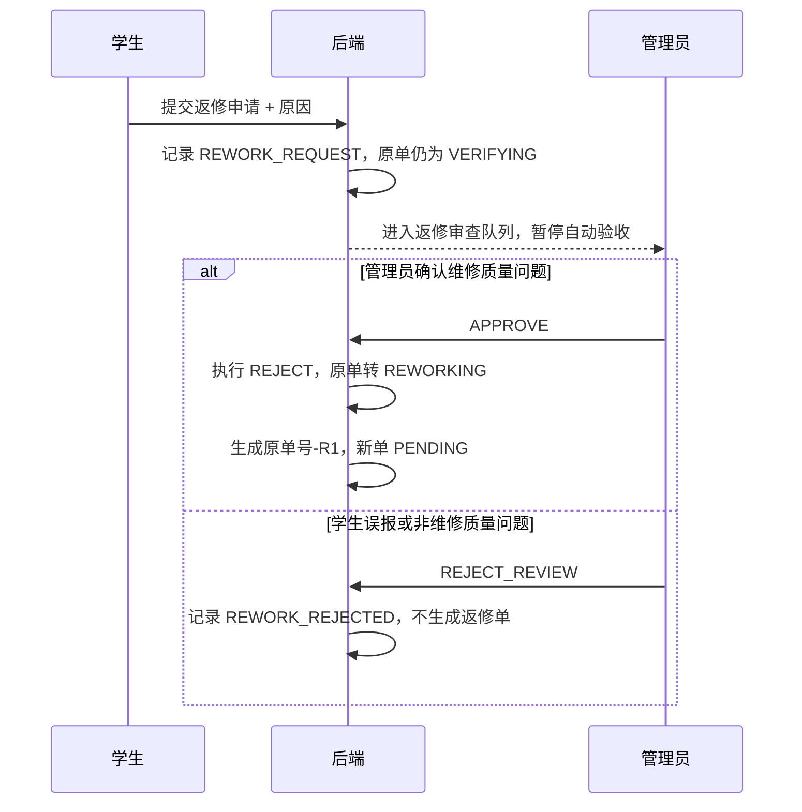

# 系统设计说明书

| 项 | 内容 |
|---|---|
| 文档编号 | SYS-005 |
| 版本 | V1.2 |
| 状态 | ✅ V1.2 已实现并完成验收 |
| 更新日期 | 2026-11-18 |
| 维护人 | 曾祥鹏 |
| 上游依据 | `需求报告-V5.0.md`、`SYS-003_接口契约.md`、`SYS-004_状态机设计.md` |
| 设计范围 | 总体架构、模块边界、核心流程、返修审查、数据设计、接口分区、安全与部署 |

> 本文负责系统总体设计。状态与事件名称以 SYS-004 为准，接口字段与错误响应以 SYS-003 为准；本文对两者之间的冲突给出落地口径。

---

## 一、设计目标与约束

系统服务于宿舍报修闭环：学生提交 → 系统定级与派工 → 师傅进楼维修 → 学生验收 → 归档。设计约束如下：

1. **主流程自动化**：正常工单不依赖人工审批，前端、后端和 AI 服务可以独立部署与启动。
2. **返修必须人工审查**：学生申请返修后，管理员先核对维修质量；确认后才生成返修单，误报则驳回申请。
3. **状态唯一入口**：工单状态只能由 `OrderStateService.transit()` 修改，合法转移只存在于 `TransitionTable.java`。
4. **AI 不阻断业务**：AI 只输出分类与紧急度；超时、断网或格式异常时必须降级，不得阻止建单。
5. **全链路留痕**：提交、定级、派工、到访、维修、验收、审查和归档均写入事件时间线。
6. **课程场景可运维**：采用单机五进程（三前端 + 后端 + AI）和 MySQL，不引入 Kubernetes、消息队列等超出项目规模的基础设施。

---

## 二、总体架构

| 服务 | 目录 | 端口 | 职责 |
|---|---|---:|---|
| 学生端 | `app/student-web` | 5173（开发） | 学生报修、验收、返修申请；`/api` 代理到 8082 |
| 师傅端 | `app/worker-web` | 5174（开发） | 本楼待办、到门、完工、缺件登记；`/api` 代理到 8082 |
| 管理端 | `app/admin-web` | 5175（开发） | 返修审查、例外、配件到货、配置与台账；`/api` 代理到 8082 |
| 后端 | `app/server` | 8082 | 鉴权、工单命令、状态机、查询、计时任务、MySQL 持久化 |
| AI 服务 | `app/ai` | 8001 | 规则定级、可选 LLM 复核、健康检查；不连数据库、不改工单 |
| 数据库 | MySQL 8 | 3306 | 工单、事件、照片地址、配件、例外、配置与单号序列 |

**边界原则**：AI 判错只影响分类和紧急度，不影响工单合法性；前端不保存业务真相；后端是状态、权限和时间的唯一权威。

---

## 三、模块设计

### 3.1 后端分层

| 层 | 主要包 | 责任 |
|---|---|---|
| 接口层 | `controller` | 参数校验、身份解析、返回统一响应；不写业务判断 |
| 业务层 | `service` | 建单、派工、维修、验收、返修、撤销、查询和计时 |
| 状态机 | `statemachine` | 9 个状态、14 条转移、触发方和非法组合校验 |
| 持久层 | `store` / `mapper` | 内存仓库与 MyBatis-Plus 双实现；数据库映射 |
| 鉴权 | `auth` | 登录、PBKDF2 口令校验、数据库摘要 TokenStore、AuthFilter |
| 公共层 | `common` / `dto` | 统一错误、响应、时间、身份和请求对象 |

### 3.2 前端分层

- 三端分别是 `student-web`、`worker-web`、`admin-web`，各自拥有页面、路由、API、会话与构建；禁止跨应用导入页面或命令。
- 每端 `src/api/request.js` 是本端唯一 HTTP 出口，统一注入令牌、剥离响应包装并转换 409/422 文案。
- `@dorm/contract` 提供只读状态/事件契约；每端 `constants/` 只放本端展示辅助，不共享身份或路由。
- 每端 `router.js` 只注册本角色路由并在受保护路由调用 `/auth/me`；学生、师傅使用 430 宽手机布局，管理端使用 1440 桌面布局。

### 3.3 AI 服务分层

- `rules.py`：关键词分类、安全闸、置信度保守升档。
- `classifier.py`：规则与模型合并，安全类优先，紧急度取较高值，失败回退规则。
- `llm.py`：OpenAI 兼容接口封装、超时和可用性控制。
- `app.py`：`/health`、`/classify`、`/rules`、`/warmup`。

---

## 四、核心流程

### 4.1 建单与定级

1. 学生提交照片、描述、楼栋、房间和可上门时段。
2. 后端校验照片至少 1 张、描述至少 4 字。
3. 后端调用 AI 快速分类；若 AI 超时或不可用，使用本地保守档并记录 `FALLBACK`。
4. 生成 `BXyyyyMMddNNN` 单号，工单进入 `PENDING`。
5. 可选的 LLM 复核在后台执行，只更新分类、紧急度和判断依据，不修改状态。

### 4.2 派工、维修与验收

自动派工先在 `t_worker_building` 中限定可服务楼栋，再按故障类别匹配承接班组：给排水、电气、电器由水电班承接，门窗家具、网络由综合班承接。楼栋内无匹配班组时，退回该楼栋主责师傅并在 `ASSIGN` 事件中记录兜底依据；管理员指定师傅仍按楼栋范围校验。

### 4.3 返修审查（已实现）

返修不再由学生直接触发状态转移，而是先进入管理员审查：

具体规则：

- 每次返修都必须审查，不设免审次数；`-R2`、`-R3` 同样适用。
- 审查期间原单保持 `VERIFYING`，完整保留照片、到访记录、AI 依据和事件时间线。
- 审查通过后，原单转入 `REWORKING`；新单继承位置、照片、分类和描述，紧急度升一档并进入 `PENDING`。
- 审查驳回后，不生成返修单，原单继续正常验收；T1 从审查决定时刻重新计时，避免管理员审查期间被自动验收。
- 第 2 次及以后仍须审查，并同时生成 `REPEAT_REWORK` 例外记录。
- 使用事件表记录审查链路，不新增状态：申请事件 `REWORK_REQUEST`，通过时沿用 `REJECT`，驳回事件 `REWORK_REJECTED`。

> 该审查门禁已实现：学生只提交申请，管理员调用审查接口；批准后才写入 `REJECT` 并生成 `-R{n}`，SYS-003、SYS-004、接口与测试已同步。

---

## 五、状态与并发设计

### 5.1 状态机

- 9 个状态：`PENDING`、`ASSIGNED`、`REPAIRING`、`PARTS`、`VERIFYING`、`REWORKING`、`DONE`、`CLOSED`、`CANCELLED`。
- 14 条合法转移；返修审查通过复用 `VERIFYING + REJECT -> REWORKING`，不增加状态或合法边。
- `REWORK_REQUEST` 和 `REWORK_REJECTED` 是只记录、不改状态的业务事件。
- 非法转移返回 `409 STATE_CONFLICT`，并返回 `from`、`event`、`allowed`。

### 5.2 并发与一致性

- 工单主表使用 `version` 乐观锁；更新条件为 `no + version`，受影响行数不为 1 时返回 `409 VERSION_CONFLICT`。
- 状态变更、事件追加、返修子单创建和例外写入必须在同一事务中完成。
- 批量派工、楼栋打卡逐单独立事务，允许部分成功。
- 客户端不得传操作时间；所有时间由服务端按 `Asia/Shanghai` 生成。

---

## 六、数据设计

### 6.1 表清单

| # | 表名 | 用途 |
|---:|---|---|
| 1 | `t_student` | 学生身份、住宿位置与口令 |
| 2 | `t_worker` | 师傅身份、班组与口令 |
| 3 | `t_admin` | 管理员身份、部门与口令 |
| 4 | `t_worker_building` | 师傅可服务楼栋的多对多关系 |
| 5 | `t_building` | 楼栋主数据 |
| 6 | `t_building_floor` | 楼栋楼层主数据 |
| 7 | `t_work_order` | 工单主表、状态、版本、返修关系和各阶段时间 |
| 8 | `t_work_order_event` | 只增不改的事件时间线 |
| 9 | `t_work_order_photo` | 现场照、完工照的 URL 与上传人 |
| 10 | `t_part` | 配件台账、规格、价格和库存 |
| 11 | `t_part_request` | 缺件申请、预算判断和到货状态 |
| 12 | `t_rework_review` | 每次返修申请与管理员决定 |
| 13 | `t_exception_record` | 数据不符、超预算、反复返修、撤销申请 |
| 14 | `t_config` | 预算线、验收时长、归档天数等配置 |
| 15 | `t_seq` | 按日分配工单序号，避免并发撞号 |

### 6.2 关键关系与规则

- `t_work_order.rework_of` 自关联原单号，`rework_index` 记录第几次返修。
- 楼栋、房间、学生姓名和分类在工单中保留快照；学生换寝室不能改写历史工单。
- 工单不使用数据库外键，由应用层保证一致性；表间通过工单号、用户号、楼栋号关联。
- 不把配件列表、照片数组或审查记录塞进 JSON 列；照片入 `t_work_order_photo`，配件入 `t_part_request`，审查入事件时间线。
- 事件表的 `manual` 由服务端根据身份生成；系统为 0，学生、师傅、管理员为 1。
- 返修审查以 `t_rework_review` 为事实源，状态为 `PENDING/APPROVED/REJECTED`；`(order_no,attempt_no)` 保留每次申请，`(order_no,rework_index)` 在批准后防止同一返修轮次重复。

### 6.3 索引重点

- `t_work_order(status, building_id)`：管理端筛选和派工。
- `t_work_order(worker_id, status)`：师傅待办。
- `t_work_order(student_id, created_at)`：学生历史工单。
- `t_work_order_event(order_no, seq)`：时间线。
- `t_rework_review(status, requested_at)`：返修审查队列。
- `t_rework_review(order_no, attempt_no)`：申请轮次唯一。
- `t_work_order(verify_due_at)` / `t_work_order(archive_due_at)`：T1/T2 扫描。
- `t_exception_record(kind, status)`：例外清单。

---

## 七、接口设计

详细字段与响应见 `SYS-003_接口契约.md`。本设计新增或调整以下返修接口：

| 方法 | 路径 | 调用方 | 行为 |
|---|---|---|---|
| `POST` | `/api/v1/orders/{no}/rework-request` | 学生 | 记录 `REWORK_REQUEST`，不改状态，返回 `202`，暂停自动验收 |
| `POST` | `/api/v1/orders/{no}/rework-review` | 管理员 | `decision=APPROVE` 时执行 `REJECT` 并生成 `-R1`；`decision=REJECT` 时记录 `REWORK_REJECTED`，不改状态 |

统一约束：

- 写请求携带 `version`；审查通过和子单创建必须在同一事务。
- 学生不能调用审查接口；管理员不能替学生提交验收或发起返修。
- 成功返回 `{ok:true,data}`；失败返回 `{ok:false,error}`。
- `409` 表示状态或版本冲突，`403` 表示角色越权，`422` 表示前置条件不满足。

---

## 八、安全、配置与部署

- 正式鉴权使用 `Authorization: Bearer <token>`；口令使用 PBKDF2 哈希，会话摘要持久化在 `t_auth_session`，支持重启恢复与撤销。同一账号默认仅保留最近 5 个活动会话，可用 `APP_AUTH_MAX_ACTIVE_SESSIONS` 调整。
- 演示用 `X-Actor-*` 请求头仅测试或演示开启，生产必须设置 `APP_AUTH_ALLOW_HEADER=false`。
- 数据库连接使用 `DB_*` 环境变量；AI 地址与超时使用 `AI_SERVICE_URL`、`AI_TIMEOUT_MS`、`AI_REVIEW_TIMEOUT_MS`。
- AI 密钥放 `app/ai/.env.local`，不得入库；仓库禁止提交 `.env`、日志和构建产物。
- 部署端口为 AI 8001、后端 8082、学生端 5173、师傅端 5174、管理端 5175；三端独立构建与部署，`/api` 均代理到 8082。
- 照片支持真实上传、私有读取与本地/S3 兼容存储；生产对象存储桶与目标环境仍待部署验证。

---

## 九、非功能与测试

| 项目 | 目标 | 验证 |
|---|---|---|
| 建单响应 | AI 快速路径毫秒级；超时按保守档返回 | 注入 AI 超时、断网 |
| 状态一致性 | 非法转移 409 且状态、版本不变 | JUnit 状态机测试、MockMvc |
| 并发 | 同一工单仅一个请求成功 | 乐观锁并发用例 |
| 返修审查 | 每次审查有事件、有审查人、有结论 | 新 API 用例 + 时间线断言 |
| 计时器 | T1 168 小时、T2 7 天，互不混用 | 定时任务与查询测试 |
| 前端 | 三端独立构建、会话隔离和角色越权拒绝 | 三端 `npm run build`、`check-three-apps.mjs`、浏览器核对 |

必须覆盖的反向场景：学生直接调用审查接口、管理员代替学生验收、重复审查、驳回后重复生成返修单、审查期间自动验收、版本冲突。

---

## 十、实现状态与后续增强

| 项目 | 当前状态 | 后续动作 |
|---|---|---|
| 五进程架构 | 已实现 | 保持 |
| 9 状态 / 14 转移 | 已实现 | 保持 |
| 人员表 | ✅ 已拆为 `t_student/t_worker/t_admin` 及师傅楼栋关联表 | 保持 |
| 数据库表数 | ✅ 新库 20 张业务表 + 1 个兼容视图；运行库另有 `t_schema_migration`，共 21 张表 | 保持 |
| 返修审查 | ✅ `t_rework_review` + 事件审计 | 保持 |
| 返修单生成 | ✅ 先 `REWORK_REQUEST`，管理员审批后生成 | 保持 |
| `REJECT` 触发方 | ✅ 管理员审查通过后触发；旧学生路径已关闭并返回 410 | 旧路径已关闭，不再恢复 |
| SYS-003 | ✅ 已补返修申请/审查接口和审计事件 | 保持 |
| 照片存储 | ✅ 真实上传、私有读取、S3 兼容存储已实现 | 生产桶与生命周期待目标环境验证 |
| Token 持久化 | ✅ 已使用 `t_auth_session` 持久化摘要、撤销与过期 | 保持 |
| 幂等 | ✅ 关键写命令支持 `Idempotency-Key` | 保持 |
| 性能测试 | ✅ 本地 200 请求、并发 20，P95 270.36 ms、错误率 0 | 目标环境容量与压测待完成 |

---

## 十一、设计结论

- 系统采用三个独立 Vue 应用、Spring Boot、FastAPI 分层，职责边界清晰，课程环境可独立运行。
- 工单状态机是业务核心，返修审查通过复用现有状态和转移实现，不增加状态位。
- 人员按学生、师傅、管理员分表；返修审查独立成表，计时使用明确的到期字段。
- 返修审查必须前置于返修单生成；学生误报时按正常验收、归档流程回流，避免对师傅不公。
- 当前实现以本文和修订后的需求报告为准；SYS-003、SYS-004、代码与测试已在同一变更批次完成同步。
