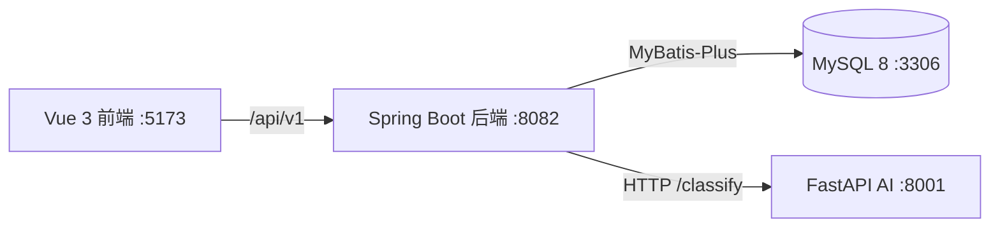
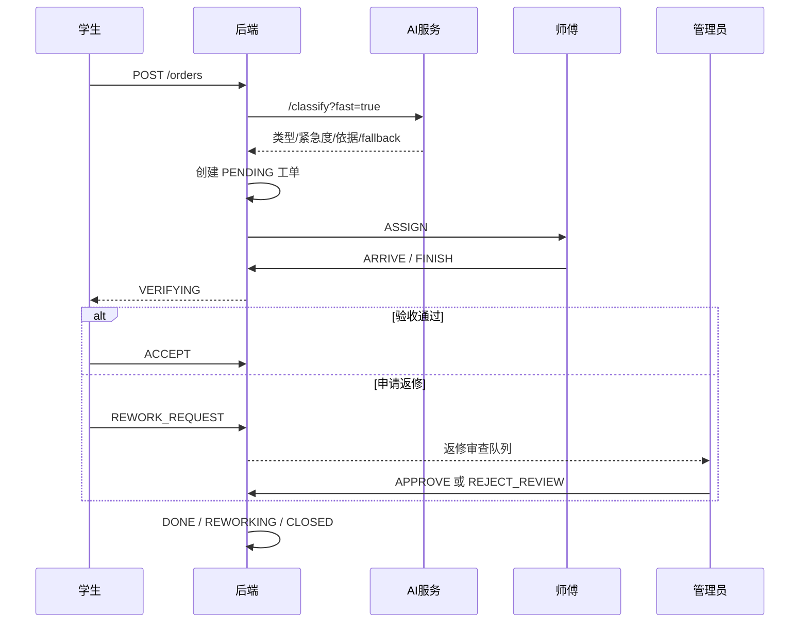

# 系统开发总览

| 项 | 内容 |
|---|---|
| 文档编号 | DEV-01 |
| 版本 | V1.0 |
| 状态 | 已对标 SYS-005，评审完成 |
| 更新日期 | 2026-11-18 |
| 上游依据 | `SYS-005_系统设计说明书.md`（V1.2 审查轮次基线） |

## 一、开发目标

系统用三个可独立启动的服务完成宿舍维修闭环：

- 学生提交报修并查看进度、验收或申请返修。
- 系统完成 AI 定级、排队派工、超时验收和到期归档。
- 师傅完成到门打卡、维修、缺件登记和完工提交。
- 管理员处理返修审查、撤销审批、超预算、数据不符和反复返修。

## 二、服务与部署

| 服务 | 启动命令 | 说明 |
|---|---|---|
| AI | `cd app\ai; python -m uvicorn app:app --host 127.0.0.1 --port 8001` | 规则优先，可切换 LLM |
| 后端 | `cd app\server; mvn spring-boot:run` | 状态、权限、事务和持久化 |
| 前端 | `cd app\web; npm run dev` | 三端页面，`/api` 代理到 8082 |
| 数据库 | MySQL 8，执行 `db/schema.sql`、`db/data.sql` | 默认库 `dorm_repair` |

> 端口基准来自 SYS-005 服务表：前端 5173、后端 8082、AI 8001；配置、启动脚本和验收脚本已统一。

## 三、主流程

## 四、关键实现约束

1. 状态修改只能走 `OrderStateService.transit()`；合法边只在 `TransitionTable`。
2. 状态、事件、副作用字段和返修子单在同一事务完成。
3. 每次转移使用 `version` 乐观锁；冲突返回 409。
4. AI 超时不得阻断建单；提交走快速规则，模型只做后台复核。
5. 前端不保存业务真相；按钮由状态、身份和接口 `allowed` 共同决定。
6. 返修审查期间原单保持 `VERIFYING`；审批通过后才进入 `REWORKING` 并生成新单。
7. 任何新增状态、事件或接口都先更新 SYS-003/SYS-004，再改代码与测试。

## 五、开发顺序

1. 数据库与权限基础：用户、楼栋、工单、事件、照片、配置。
2. 状态机与命令链：建单、派工、到访、完工、验收、撤销。
3. AI 快速定级与后台复核。
4. 计时器、例外清单与管理端统计。
5. 返修审查接口、管理端队列和测试同步。
6. 前端联调、截图核对和端到端验收。

## 六、实现状态

| 能力 | 代码状态 | 目标 |
|---|---|---|
| 三服务与主链 | ✅ 已有 | 保持 |
| 返修审查 | ✅ 已实现 | 学生申请、管理员批准/驳回、R1/R2 与例外 |
| Bearer Token 登录 | ✅ 已实现 | 生产可继续升级为持久化会话 |
| 照片上传 | ⚠️ `demo://` 占位 | 接对象存储 |
| 前端返修审查队列 | ✅ 已实现 | 管理端队列、批准/驳回与反馈 |
