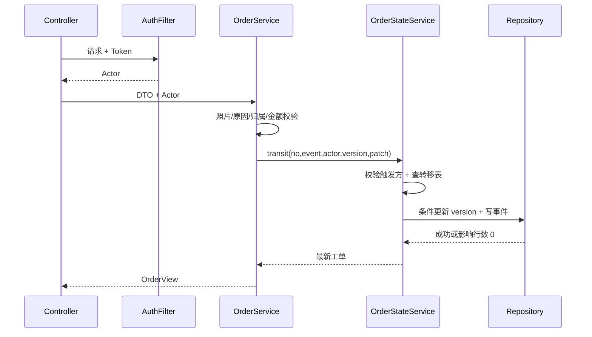

# 后端开发设计

| 项 | 内容 |
|---|---|
| 文档编号 | DEV-03 |
| 版本 | V1.0 |
| 状态 | ✅ 已实现并完成接口、数据库与回归验收 |
| 更新日期 | 2026-11-18 |
| 上游依据 | `SYS-005_系统设计说明书.md`（V1.2 审查轮次基线） |
| 技术栈 | Java 17、Spring Boot 4.0.9、MyBatis-Plus、MySQL 8 |

> 后端端口为 8082；`application.yml`、启动脚本、测试脚本和文档已同步。

## 一、包结构与职责

```text
com.zxp.dormrepair
├─ controller/     参数校验、身份解析、统一响应
├─ service/        命令、查询、AI、计时器和种子数据
├─ statemachine/   状态、事件、转移表、矩阵与触发方
├─ store/          仓库接口、内存实现、MyBatis 实现、Mapper、Entity
├─ auth/           登录、PBKDF2、TokenStore、AuthFilter
├─ common/         错误、响应、身份解析、时间工具
├─ dto/            请求与工单视图
└─ domain/         WorkOrder、Actor、OrderEventLog
```

Controller 不写状态判断，Service 只处理业务前置，状态合法性统一交给 `OrderStateService`。

所有出参字段以 `04-前后端API接口.md` 为准。`OrderView.reworkReview` 已实现，普通工单该字段为 null 或被省略。

## 二、命令请求生命周期



### 状态更新六步

1. `store.require(no)` 读取当前工单。
2. `StateMachine.assertCanTrigger(event, actor.type())` 校验角色。
3. `StateMachine.next(from,event)` 查合法边。
4. 用请求 `version` 执行条件更新。
5. 同一更新内写副作用字段、递增版本、追加事件。
6. 影响行数不为 1 时返回 `409 VERSION_CONFLICT`。

禁止在 Service 中执行 `order.setStatus(...)`，也禁止用 `if (status == ...)` 代替转移表。

## 三、核心服务

| 服务 | 职责 |
|---|---|
| `OrderService` | 建单、派工、打卡、完工、缺件、验收、撤销和返修 |
| `OrderStateService` | 唯一状态修改入口、事件追加、级联关闭 |
| `QueryService` | 我的工单、师傅待办、楼栋看板、例外、看板和计时器 |
| `AiClient` | 快速规则定级与慢速模型复核 |
| `AiReviewService` | 2 线程后台复核，只写分类字段，不改状态 |
| `TimerService` | T1 自动验收、T2 自动归档 |
| `AuthService` / `TokenStore` | 登录、会话、PBKDF2、令牌失效 |
| `ConfigService` | 预算线、验收小时、归档天数 |

## 四、鉴权与权限

- 正式入口：`Authorization: Bearer <token>`。
- `AuthFilter` 解析令牌并生成 `Actor`；`ActorResolver` 负责取身份和校验角色。
- 演示环境可启用 `X-Actor-*` 请求头；生产必须 `APP_AUTH_ALLOW_HEADER=false`。
- 越权优先返回 403，再判断状态冲突；调用方看到 403 时不应重试。
- 令牌当前存内存，服务重启后失效；生产应改持久化会话或可撤销 JWT。
- 人员模型已拆为 `t_student`、`t_worker`、`t_admin`；兼容视图仅用于迁移，正式读写按角色路由。

## 五、返修审查实现

实现已将原 `reject()` 拆为申请与审查，旧路径保留兼容：

1. 学生 `POST /orders/{no}/rework-request`，同一事务写入 `REWORK_REQUEST` 事件和 `t_rework_review(PENDING)`，不改变工单状态。
2. 管理端队列读取 `t_rework_review.status=PENDING`，按申请时间排序。
3. 管理员 `POST /orders/{no}/rework-review`，请求体携带 `decision`、`reason`、`version`。
4. `APPROVE`：更新审查行为 `APPROVED`，执行 `REJECT` 到 `REWORKING`，创建 `-R{n}` 子单并写 `REPEAT_REWORK` 例外。
5. `REJECT`：更新审查行为 `REJECTED` 并写 `REWORK_REJECTED` 事件，原单保持 `VERIFYING`；T1 从决定时刻重新计时。
6. 审查行、原单状态、事件和子单必须处于同一事务；`(order_no,rework_index)` 唯一约束防止重复审查。
7. 管理员不能代学生验收；学生不能调用审查接口。

```java
if ("APPROVE".equals(decision)) {
    state.transit(no, OrderEvent.REJECT, admin, reason, version, null);
    createReworkChild(no, studentActor, reason);
} else {
    state.logOnly(no, OrderEvent.REWORK_REJECTED, admin, reason, version);
}
```

`OrderEvent`、TRIGGER、SYS-003/SYS-004、前端管理端和测试已同步；旧 `/reject` 只保留迁移兼容。

## 六、错误与事务

- 统一响应：成功 `{ok:true,data}`；失败 `{ok:false,error:{code,message,...}}`。
- 409：非法状态或版本冲突；422：前置条件不满足；403：角色/归属错误；501：变更单未批准。
- 一次转移、事件、副作用字段和子单创建必须在同一事务。
- 批量打卡逐单独立事务，返回 `ok`、`failed`、`skipped`。
- 时间由 `TimeUtil` 生成，时区固定 `Asia/Shanghai`；客户端时间忽略。

## 七、测试与开发约束

```powershell
cd app\server
mvn -q -DskipTests package
mvn -q test
```

新增命令至少覆盖成功、前置失败（422）、越权（403）和状态冲突（409）。状态机改动必须同时覆盖合法链、非法边、并发版本冲突和事件副作用。
