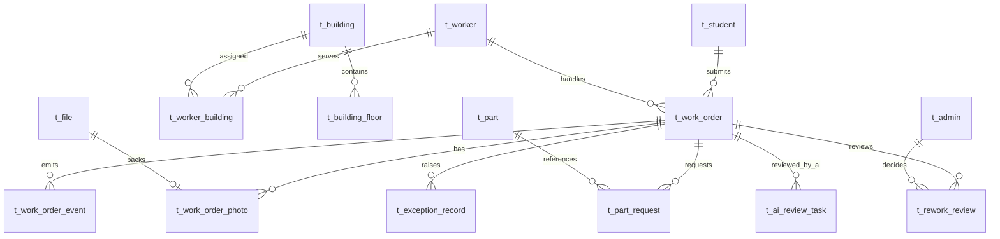

# 数据库表设计

| 项 | 内容 |
|---|---|
| 文档编号 | DEV-05 |
| 版本 | V1.2 |
| 状态 | ✅ 已实现并完成迁移、读写与约束验证 |
| 更新日期 | 2026-11-18 |
| 上游依据 | `SYS-005_系统设计说明书.md`（V1.1 修订稿） |
| 数据库 | MySQL 8.0，InnoDB，utf8mb4 |
| 正式实现 | 17 张表，学生/师傅/管理员分表，含 AI 复核审计与写请求幂等 |
| 迁移兼容 | 保留 `t_user` 与旧 `floors` 列时为 18 张；清理后 17 张 |

## 一、审查结论

原 `t_user` 把学生、师傅、管理员和登录凭据混在一张表，角色字段大量可空。现正式模型已拆为三张角色表，兼容视图只服务迁移窗口。

本修订采用“一角色一实体表”：

- 学生、师傅、管理员各自保存身份资料和口令哈希。
- 登录接口按账号前缀或显式角色选择表，不再依赖统一人员表的 `role` 字段。
- 公共接口返回统一的 `Actor`，但数据库层不把三种角色混成一张业务表。

## 二、必须修正的问题

| 级别 | 当前设计 | 问题 | 修订 |
|---|---|---|---|
| P0 | `t_user` 含 `role/team/building_id/room` | 角色字段互斥却都可空；学生、师傅、管理员语义混用 | 拆为 `t_student`、`t_worker`、`t_admin` |
| P0 | 师傅只有一个 `building_id` | 无法支持一个师傅负责多楼栋 | 增加 `t_worker_building` 关联表 |
| P0 | `t_building.floors` 用逗号字符串 | 无法索引、校验和关联楼层 | 拆为 `t_building_floor` |
| P0 | 返修审查只靠事件推导 | 待审查询复杂，无法用唯一约束防重复审查 | 增加 `t_rework_review` |
| P1 | T1/T2 每次从 `finish_at/sign_at` 现算 | 返修审查暂停后截止时间口径复杂 | 增加 `verify_due_at`、`archive_due_at` |
| P1 | `t_work_order.parts_*` 与 `t_part_request` 重复 | 可能双写不一致 | 保留快照，但明确 `t_part_request` 是事实源，同一事务更新 |
| P2 | 不使用外键 | 可能产生孤儿数据 | 课程环境保留应用层约束；生产版本建议加外键 |

## 三、目标表清单

| # | 表名 | 用途 |
|---:|---|---|
| 1 | `t_student` | 学生身份、住宿位置、口令 |
| 2 | `t_worker` | 师傅身份、班组、口令 |
| 3 | `t_admin` | 管理员身份、部门、口令 |
| 4 | `t_worker_building` | 师傅与楼栋多对多关系 |
| 5 | `t_building` | 楼栋主数据 |
| 6 | `t_building_floor` | 楼栋楼层主数据 |
| 7 | `t_work_order` | 工单主表与状态、时间、返修关系 |
| 8 | `t_work_order_event` | 只增不改的事件时间线 |
| 9 | `t_work_order_photo` | 现场照、完工照 URL 与文件 ID 关联 |
| 16 | `t_file` | 私有对象键、MIME、大小、SHA-256、上传人和工单绑定 |
| 10 | `t_part` | 配件目录与库存 |
| 11 | `t_part_request` | 缺件申请、预算判断、到货状态 |
| 12 | `t_rework_review` | 每次返修申请与管理员决定 |
| 13 | `t_exception_record` | 需要人工处理的例外记录 |
| 14 | `t_config` | 预算线、验收时长、归档天数 |
| 15 | `t_seq` | 按日分配工单序号 |
| 16 | `t_ai_review_task` | AI 复核任务、模型调用结果、错误与写回审计 |
| 17 | `t_idempotency_record` | 关键写请求的幂等键、请求摘要与首次成功响应 |

### 3.1 幂等记录

`t_idempotency_record` 以 `(actor_type, actor_id, method, path, idempotency_key)` 唯一。保存请求摘要 SHA-256、`PROCESSING/COMPLETED` 状态、首次成功 HTTP 状态和响应体；先原子占位，成功写结果，失败释放占位。相同 key 与相同请求在完成后重放首次响应，处理中返回冲突。

## 四、关系



`t_work_order.rework_of` 仍是自关联业务键，指向原始单号。工单保存位置和人员姓名快照，人员资料变更不重写历史工单。

## 五、核心 DDL

### 5.1 三类人员

```sql
CREATE TABLE t_student (
  id            VARCHAR(20)  NOT NULL COMMENT '学号',
  name          VARCHAR(30)  NOT NULL,
  phone         VARCHAR(20)  NULL,
  building_id   VARCHAR(10)  NOT NULL,
  room          VARCHAR(10)  NOT NULL,
  password_hash VARCHAR(200) NULL,
  active        TINYINT(1)   NOT NULL DEFAULT 1,
  created_at    DATETIME     NOT NULL DEFAULT CURRENT_TIMESTAMP,
  updated_at    DATETIME     NOT NULL DEFAULT CURRENT_TIMESTAMP ON UPDATE CURRENT_TIMESTAMP,
  PRIMARY KEY (id),
  KEY idx_student_location (building_id, room),
  KEY idx_student_active (active)
) ENGINE=InnoDB DEFAULT CHARSET=utf8mb4 COMMENT='学生';

CREATE TABLE t_worker (
  id            VARCHAR(20)  NOT NULL COMMENT '工号',
  name          VARCHAR(30)  NOT NULL,
  phone         VARCHAR(20)  NULL,
  team          VARCHAR(20)  NULL COMMENT '水电班 / 综合班',
  password_hash VARCHAR(200) NULL,
  active        TINYINT(1)   NOT NULL DEFAULT 1,
  created_at    DATETIME     NOT NULL DEFAULT CURRENT_TIMESTAMP,
  updated_at    DATETIME     NOT NULL DEFAULT CURRENT_TIMESTAMP ON UPDATE CURRENT_TIMESTAMP,
  PRIMARY KEY (id),
  KEY idx_worker_active (active),
  KEY idx_worker_team (team)
) ENGINE=InnoDB DEFAULT CHARSET=utf8mb4 COMMENT='维修师傅';

CREATE TABLE t_admin (
  id            VARCHAR(20)  NOT NULL COMMENT '管理员账号',
  name          VARCHAR(30)  NOT NULL,
  phone         VARCHAR(20)  NULL,
  department    VARCHAR(40)  NULL COMMENT '后勤部门',
  password_hash VARCHAR(200) NULL,
  active        TINYINT(1)   NOT NULL DEFAULT 1,
  created_at    DATETIME     NOT NULL DEFAULT CURRENT_TIMESTAMP,
  updated_at    DATETIME     NOT NULL DEFAULT CURRENT_TIMESTAMP ON UPDATE CURRENT_TIMESTAMP,
  PRIMARY KEY (id),
  KEY idx_admin_active (active)
) ENGINE=InnoDB DEFAULT CHARSET=utf8mb4 COMMENT='管理员';
```

账号 ID 约定使用 `S…`、`W…`、`A…` 前缀，避免跨表撞号。`/auth/login` 可按前缀选择表，或提供显式角色登录接口。

### 5.2 楼栋与师傅服务范围

```sql
CREATE TABLE t_building (
  id    VARCHAR(10) NOT NULL COMMENT 'B7',
  name  VARCHAR(30) NOT NULL,
  PRIMARY KEY (id)
) ENGINE=InnoDB DEFAULT CHARSET=utf8mb4 COMMENT='楼栋';

CREATE TABLE t_building_floor (
  building_id VARCHAR(10) NOT NULL,
  floor       INT         NOT NULL,
  PRIMARY KEY (building_id, floor)
) ENGINE=InnoDB DEFAULT CHARSET=utf8mb4 COMMENT='楼栋楼层';

CREATE TABLE t_worker_building (
  worker_id   VARCHAR(20) NOT NULL,
  building_id VARCHAR(10) NOT NULL,
  is_primary  TINYINT(1)  NOT NULL DEFAULT 0,
  PRIMARY KEY (worker_id, building_id),
  KEY idx_worker_building (building_id, worker_id)
) ENGINE=InnoDB DEFAULT CHARSET=utf8mb4 COMMENT='师傅可服务楼栋';
```

### 5.3 工单与返修审查

```sql
ALTER TABLE t_work_order
  ADD COLUMN verify_due_at  DATETIME NULL COMMENT 'T1 到期时间',
  ADD COLUMN archive_due_at DATETIME NULL COMMENT 'T2 到期时间';

CREATE TABLE t_rework_review (
  id              BIGINT       NOT NULL AUTO_INCREMENT,
  order_no        VARCHAR(20)  NOT NULL,
  attempt_no      INT          NOT NULL COMMENT '同一原单第几次申请返修',
  rework_index    INT          NULL COMMENT '批准后写入第几次返修，申请时为 NULL',
  status          VARCHAR(12)  NOT NULL COMMENT 'PENDING/APPROVED/REJECTED',
  requested_by    VARCHAR(20)  NOT NULL COMMENT '学生 ID',
  request_reason  VARCHAR(300) NOT NULL,
  requested_at    DATETIME     NOT NULL,
  decided_by      VARCHAR(20)  NULL COMMENT '管理员 ID',
  decision_reason VARCHAR(300) NULL,
  decided_at      DATETIME     NULL,
  PRIMARY KEY (id),
  UNIQUE KEY uk_review_attempt (order_no, attempt_no),
  UNIQUE KEY uk_review_rework (order_no, rework_index),
  KEY idx_rework_queue (status, requested_at),
  KEY idx_rework_order (order_no)
) ENGINE=InnoDB DEFAULT CHARSET=utf8mb4 COMMENT='返修审查';
```

### 5.4 文件元数据

`t_file` 保存服务端生成的对象键、原始文件名、MIME、字节数、SHA-256、上传人、用途、私有可见性与工单绑定。未绑定文件以 `(uploaded_by, purpose, sha256)` 通过生成列 `unbound_digest` 和唯一索引 `uk_file_unbound_digest` 去重；绑定后生成列为 `NULL`，允许后续再次上传同一图片。`t_work_order_photo` 增加 `file_id` 与索引；旧 demo 协议行的 `file_id` 为空。对象桶必须私有，读取统一经过 `/files/{id}` 权限校验。

### 5.4.1 AI 复核任务

`t_ai_review_task` 每次后台模型复核创建一行，记录 `order_no/order_version/input_hash/model/provider/status/attempts/requested_at/completed_at/error_code/error_message/category/level/confidence/basis/source/latency_ms/applied/applied_at`。任务状态为 `PENDING/RUNNING/SUCCEEDED/FALLBACK/FAILED/SUPERSEDED`。

`input_hash` 是描述文本的 SHA-256，不保存学生原文。只有 `applied=true` 表示结果已按原版本写回；工单已推进或版本变化时标记 `SUPERSEDED`。AI 任务不能改变工单状态。

### 5.5 工单主表保留的快照

`t_work_order` 仍保留 `student_id/student_name`、`worker_id/worker_name`、`building_id/floor/room`、`parts_*` 等快照字段，用于历史追溯和列表展示。快照不是关系表的主数据；人员或房间变更不能反写历史工单。

## 六、返修审查状态

| `t_rework_review.status` | 工单动作 |
|---|---|
| `PENDING` | 原单保持 `VERIFYING`，暂停 T1，进入管理端审查队列 |
| `APPROVED` | 原单 `REWORKING`，创建 `-R{n}` 新单 `PENDING` |
| `REJECTED` | 原单保持 `VERIFYING`，无新单，T1 从决定时刻重新计算 |

申请时 `attempt_no = 同原单最大值 + 1`，`rework_index = NULL`；批准时再写入返修序号。`uk_review_attempt` 保留每轮申请历史，`uk_review_rework` 利用 MySQL 多 NULL 规则防止同一返修轮次重复批准。审批通过和子单创建必须在同一事务。

## 七、索引与约束

| 索引/约束 | 作用 |
|---|---|
| `t_work_order(status,building_id)` | 管理端筛选、派工 |
| `t_work_order(worker_id,status)` | 师傅待办 |
| `t_work_order(student_id,created_at)` | 学生历史 |
| `t_work_order(verify_due_at)` | T1 扫描 |
| `t_work_order(archive_due_at)` | T2 扫描 |
| `t_work_order_event(order_no,seq)` | 时间线 |
| `t_rework_review(status,requested_at)` | 审查队列 |
| `t_ai_review_task(order_no,requested_at)` | 按工单回看 AI 复核 |
| `t_ai_review_task(status,requested_at)` | 查看运行中、兜底与失败任务 |
| `t_exception_record(kind,status)` | 例外清单 |
| `t_seq(day,name)` | 并发单号 |

- 金额使用 `DECIMAL(10,2)`，状态和角色保留有限枚举。
- `t_part_request` 是配件申请事实源，`t_work_order.parts_*` 只是当前快照，二者必须同事务更新。
- 不使用外键是课程演示的折中；生产版本建议为学生、师傅、管理员、楼栋、配件加外键并使用软删除。

## 八、迁移方案

1. 已新建 `t_student`、`t_worker`、`t_admin`，从 `t_user` 按 `role` 拆分。
2. 新建 `t_worker_building`，把师傅原 `building_id` 迁成关联记录。
3. 新建 `t_building_floor`，把 `t_building.floors` 逗号串拆行。
4. 新建兼容视图 `v_user_account`，让旧 `UserMapper` 暂按统一字段读取。
5. 新建 `t_rework_review`；切换返修申请/审批逻辑。
6. 为 `t_work_order` 回填 `verify_due_at`、`archive_due_at`。
7. 代码、测试和 SYS-005/API 文档同步完成后，按“停写 → 删视图 → 删旧表/旧列”清理。

## 九、可保留的设计

- 工单位置和人员姓名快照：为保证历史可追溯，保留。
- 事件表只增不改：适合时间线和审计，保留。
- `manual` 标记：用于零人工完成率，保留。
- `t_config` 键值配置：课程项目只有少量阈值，暂时可接受；生产可改强类型配置表。
- 照片 URL 与文件元数据分离：`t_file` 保存对象键、MIME、大小、SHA-256 和绑定关系；`t_work_order_photo` 保留兼容 URL 与 `file_id`。
