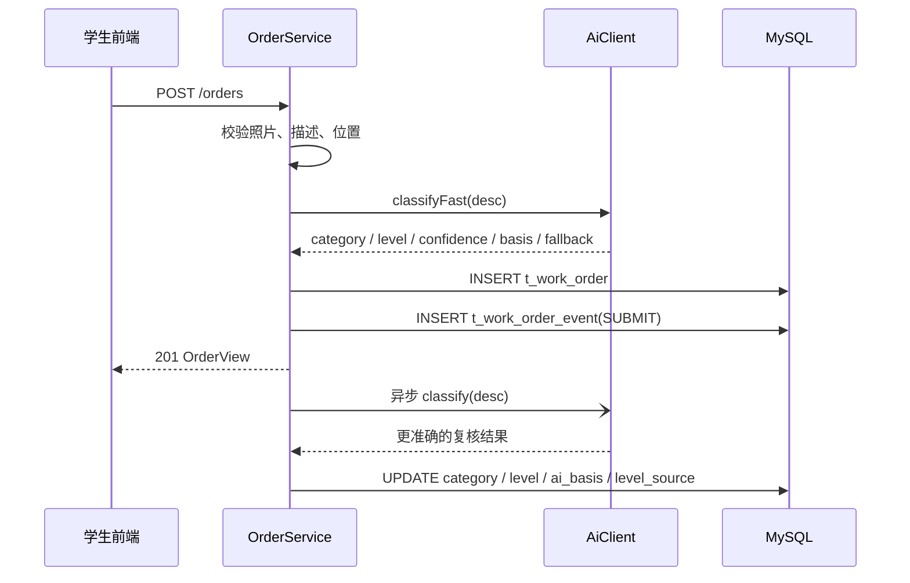

# AI 结果与工单落库

| 项 | 内容 |
|---|---|
| 文档编号 | DEV-07 |
| 版本 | V1.0 |
| 状态 | 🟡 已对标 SYS-005 V1.2，评审完成 |
| 更新日期 | 2026-11-18 |
| 上游依据 | `SYS-005_系统设计说明书.md`（V1.2 审查轮次基线） |
| 目标 | 说明 AI 结果如何从 Python 服务传到 Java 工单 |

## 一、核心结论

**AI 不“生成工单”，也不直接写数据库。** Python 只返回定级结果；Java 后端在 `OrderService.submit()` 中创建工单，把结果映射到工单字段，再由状态机创建 `PENDING`。

## 二、提交链路



## 三、字段映射

| AI 返回 | 工单字段 | 规则 |
|---|---|---|
| `category` | `category` | 必须是五类之一；非法则使用兜底 |
| `level` | `level` | 紧急/较急/普通；非法则使用兜底 |
| `basis` | `aiBasis` | 截断到列长度，保留判断依据 |
| `source` | `levelSource` | 优先记录 `AI` 或 `FALLBACK` |
| `confidence` | 当前未独立落库 | 仅在日志或依据中使用；需要审计时新增列 |
| `fallback` | 不单独落库 | 用 `levelSource=FALLBACK` 和依据文本识别 |

## 四、同步快速定级

提交请求只调用 `classifyFast()`，不能等待 LLM。Java 侧设置 1.5 秒读超时，任何异常都返回可用兜底结果。创建工单和 `SUBMIT` 事件要原子完成；AI 不可用不能导致建单失败。

```java
AiClient.Verdict v = ai.classifyFast(desc);
order.setCategory(v.category());
order.setLevel(v.level());
order.setLevelSource(v.fallback() ? "FALLBACK" : v.source());
order.setAiBasis(v.basis());
store.save(order);
review.review(order.getNo(), desc);
```

## 五、后台模型复核

- `AiReviewService` 使用 2 个守护线程，异步调用 `classify()`。
- 复核只更新 `category`、`level`、`aiBasis`、`levelSource`，不新增事件、不改变状态、不重新派工。
- 复核结果为空或失败时，保留快速定级。
- 已实现更新前检查：只有 `PENDING/ASSIGNED` 接受复核结果；若工单已派工或推进，使用 CAS 让晚到结果失效。
- 复核不能影响学生提交耗时，也不能把 HTTP 请求线程绑定到模型供应商。

## 六、兜底矩阵

| 情况 | 结果 |
|---|---|
| AI 正常返回合法 JSON | 使用返回值 |
| 安全类规则命中 | 直接使用规则结果，不调模型 |
| 超时/连接失败 | 类别给排水、级别较急，标 `FALLBACK` |
| 返回空内容 | 同上，依据记录“返回空内容” |
| 类别或级别非法 | 不覆盖现有结果，回退规则 |
| LLM 两次都不合规 | 使用规则结果，记录模型失败原因 |

## 七、审计与后续改造

当前工单保存的是生效分类和级别，`confidence` 没有独立字段。若需要完整 AI 审计，建议：

1. 增加 `ai_confidence`、`ai_source` 两个可空列；
2. 或增加 `AI_REVIEWED` 事件，记录模型名、耗时、原始结果和是否覆盖；
3. 任何新增事件不得改变状态机边数，只作为时间线记录。

## 八、验收

- AI 关闭时学生仍能建单，工单进入 `PENDING`。
- 安全类描述即使 AI 不可用也至少走本地安全关键词兜底。
- AI 复核成功时只改变分类字段，状态和版本不因复核而异常跳变。
- 记录能说明每个工单的分类来源和兜底原因。
