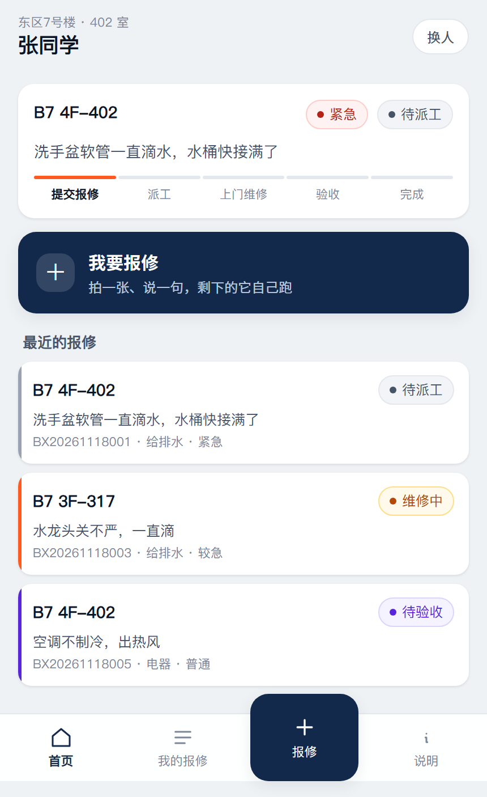
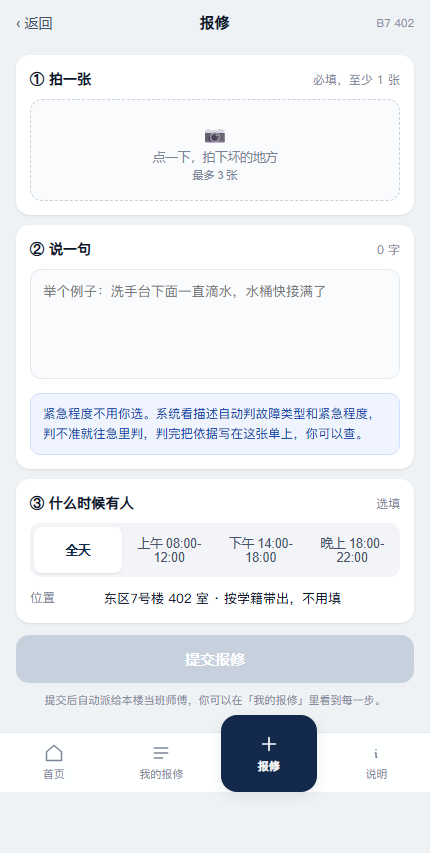
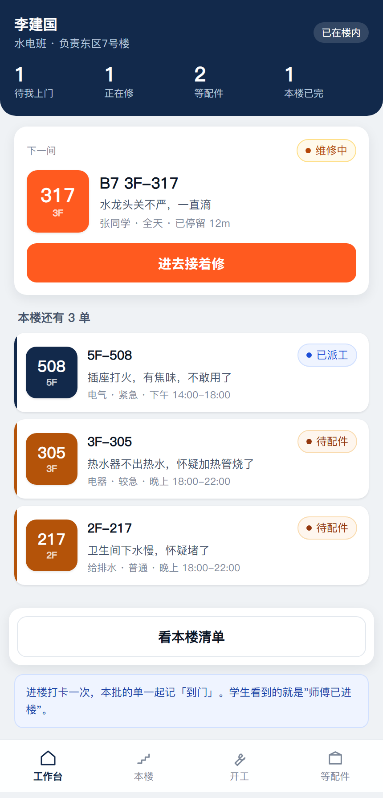
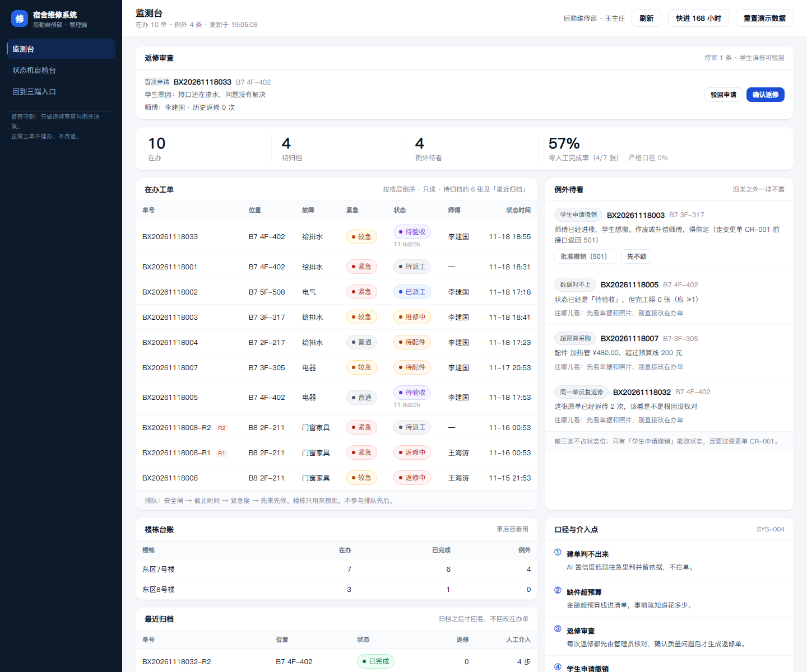

# UI 界面设计

| 项 | 内容 |
|---|---|
| 文档编号 | DEV-08 |
| 版本 | V1.1 |
| 状态 | ✅ 三端独立界面已实现并完成浏览器验证 |
| 更新日期 | 2026-11-18 |
| 上游依据 | `SYS-005_系统设计说明书.md`（V1.2 审查轮次基线） |
| 实现 | Vue 3 + Element Plus + CSS 设计令牌 |
| 运行入口 | `app/student-web` :5173、`app/worker-web` :5174、`app/admin-web` :5175 |

## 一、视觉方向

- 深海军蓝表达维修工装与秩序，橙色只用于当前行动和紧急信息。
- 页面底色浅灰蓝，卡片纯白，圆角 14 px，阴影克制。
- 数字使用等宽数字，状态统一使用胶囊和颜色编码。
- 学生端、师傅端是 430 px 手机页；管理端是 1440 px 桌面页，不做成手机壳。
- 装饰必须携带信息，例如师傅端门牌的颜色表示工单状态。

## 二、设计令牌

| 令牌 | 值 | 用途 |
|---|---|---|
| `--navy` | `#12294b` | 师傅端深色头部、品牌 |
| `--orange` | `#ff5a1f` | 当前操作、重要提醒 |
| `--bg` | `#eff2f5` | 手机页背景 |
| `--card` | `#ffffff` | 卡片 |
| `--ink` | `#0b1524` | 主文字 |
| `--ink-2` | `#46536a` | 次文字 |
| `--line` | `#e3e8ee` | 分隔线 |
| `--ok` | `#067647` | 完成 |
| `--warn` | `#b54708` | 待处理/较急 |
| `--danger` | `#b42318` | 故障/紧急 |
| `--violet` | `#5925dc` | 返修关系与待验收 |

## 三、页面清单

| 页面 | 关键结构 |
|---|---|
| 学生首页 `/student` | 欢迎语、当前进度、工单卡片、底部导航 |
| 学生报修 `/student/new` | 位置选择、故障描述、照片、时段、提交 |
| 学生列表 `/student/list` | 状态筛选、工单摘要、状态胶囊 |
| 学生详情 `/student/detail/:no` | 五步进度、时间线、照片、验收/返修 |
| 师傅工作台 `/worker` | 深蓝头部、待办统计、门牌卡片、楼层摘要 |
| 楼栋打卡 `/worker/building` | 楼层队列、整楼打卡、到访结果 |
| 师傅作业 `/worker/task/:no` | 工单信息、行动按钮、完工照、返修关系 |
| 待配件清单 `/worker/parts` | 配件金额、预计到货、预算提示；师傅只读 |
| 管理端 `/admin` | 侧栏、指标卡、返修审查、例外清单、配件到货与配置 |

## 四、关键界面

### 4.1 学生首页

- 顶部显示学生身份、楼栋和房间。
- 主卡展示当前工单进度；辅助卡展示历史与返修单。
- 主按钮固定为“我要报修”，导航固定底部。

### 4.2 学生报修

- 位置默认带出学生住宿信息，可修改。
- 描述必填至少 4 字；照片至少 1 张。
- 可上门时段选填，不填按全天。
- 提交后显示 AI 定级与依据，不等待慢模型。

### 4.3 师傅工作台

- 头部用深蓝色，统计待办、已派、缺件和紧急数。
- 门牌左侧显示房间，颜色表示状态，紧急单使用红色描边。
- 当前工单的行动按钮固定在底部，避免长列表找不到入口。

### 4.4 管理端

- 左侧深色导航，右侧指标卡、楼栋台账和例外表。
- 表格保持密集、只读优先；只有审查/配置等明确动作可写。
- 桌面宽度下不出现底部手机导航。

## 五、返修审查界面

- 学生详情：验收区新增“申请返修”，弹出原因输入；提交后显示“返修审查中”，状态仍显示待验收。
- 管理端：看板顶部显示“返修审查”，列表字段为工单号、位置、师傅、返修次数、申请时间、等待时长。
- 审查弹层：展示学生原因与当前原单信息，管理员必须填写审查意见。
- 操作：`确认返修` 使用强调色，`驳回申请` 使用次级按钮；两者都必须填写理由或选择固定原因。
- 确认后提示“已生成 -R1”，并刷新原单与子单；驳回后提示“申请已驳回，原单继续验收/归档”。
- 审查中的工单不新增状态胶囊，采用 `待验收 + 返修审查中` 的组合标签。

## 六、交互与可访问性

- 所有可点击元素具有 hover/focus/disabled 状态；手机按钮高度不小于 44 px。
- 409 显示“状态已变化，请刷新”，并刷新详情；422 就地显示原因。
- 颜色不是唯一信息通道，状态同时显示文字与圆点/门牌。
- 图片必须有 alt 文本；空列表、加载中、网络失败分别设计状态。
- 手机端适配安全区；桌面端最小宽度 1280，表格允许横向滚动。

## 七、UI 验收

- 三个独立应用均可启动，所有本端路由可访问且无控制台错误。
- 430 px 宽度无横向溢出；1440 px 管理端表格不挤压。
- 状态颜色、标签和按钮与接口 `allowed` 一致；师傅端不出现管理员命令，学生端不出现派工命令。
- 返修审查页在空队列、待审、已通过、已驳回四种状态均有明确反馈。

## 管理端人员管理

- 入口：`/admin/people`，仅 ADMIN 可进入。
- 列表展示账号、角色、姓名、班组/楼栋、电话、启用状态；不展示口令哈希。
- 支持创建学生、师傅、管理员，以及重置口令。
- 师傅建号必须填写服务楼栋；学生建号必须填写楼栋和房间。
- 桌面 1440 px 使用密集表格；窄屏保留横向滚动，不压缩操作按钮。
