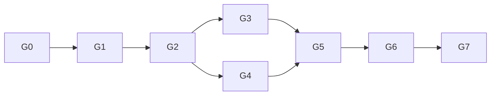

# 开发总计划与里程碑

| 项 | 内容 |
|---|---|
| 文档编号 | DPLAN-01 |
| 版本 | V1.2 |
| 状态 | ✅ 已完成（2026-11-18 验收回填） |
| 上游依据 | `SYS-005_系统设计说明书.md` V1.1、`系统开发设计/README.md` V1.2 |
| 周期 | 17.5 人日 + 0.5 日缓冲 = 18 个工作日 |

## 一、目标

把当前实现迁移到已审查设计：分角色人员表、返修审查表、管理员触发 REJECT、日志型审查事件、T1 暂停、Repository 写路径、按楼栋派工、8082/8001 端口和 API V1.1 字段契约。

## 二、成功标准

1. 迁移期保留 `t_user` 时为 16 张表；删除兼容视图和 `t_user` 后为 15 张。
2. 学生申请返修不改状态；管理员批准后才生成 `-R1`。
3. 审计事件不改变状态，也不增加 13 条状态转移和 130 矩阵。
4. T1 在审查期间暂停，批准后终止，驳回后从决定时间重新计时。
5. `t_worker_building` 真正参与派工，不再使用硬编码师傅。
6. 所有 API 字段与 `04-前后端API接口.md` V1.1 一致。
7. CG01–CG14 使用新口径重新生成。
8. G0 门禁包含计划文件和老计划归档进入 Git 版本管理。

## 三、阶段、任务与门禁

| 阶段 | 包含任务 | 主要工作 | 门禁产物 | 预计 | 状态 |
|---|---|---|---|---:|---|
| G0 基线冻结 | T01 | 冻结设计、表数、G 阶段编号和端口 | 计划评审；旧计划归档进入版本管理 | 0.5d | ✅ |
| G1 数据与账号迁移 | T02,T03,T04,T05 | 分角色表、楼栋关系、审查表、到期字段、Repository 读写路径 | 迁移对账与三角色写入测试 | 4.5d | ✅ |
| G2 后端行为改造 | T04a,T04b,T04c,T06,T06b,T07 | REJECT 触发方、审计事件、T1、审查接口、自动派工、端口 | 后端接口与单测 | 5d | ✅ |
| G3 AI 对接 | T11 | 8001 端口、规则/模型复核、超时 | AI 联调记录 | 0.5d | ✅ |
| G4 前端与 UI | T08,T09,T10 | 登录、字段适配、审查队列、学生申请 | 页面截图与构建 | 3.5d | ✅ |
| G5 API 联调 | T12 | 字段、权限、错误码、旧接口兼容 | 联调清单全绿 | 1d | ✅ |
| G6 测试与质量 | T13 | 迁移、状态机、审查、计时、AI、UI | 测试报告 | 1.5d | ✅ |
| G7 发布与交付 | T14,T15 | 发布包、回滚演练、CG 重生成 | 可交付版本 | 1d | ✅ |
| 缓冲 | — | 缺陷与返工 | 无新增致命/严重缺陷 | 0.5d | ✅ |

**G0–G7 合计 17.5d，加 0.5d 缓冲为 18d。**

## 四、依赖顺序

单人执行顺序：G0 → G1 → G2 → G4 → G3 → G5 → G6 → G7。G3 与 G4 不并行；AI 联调穿插在 D11。

## 五、门禁

- G0 未完成：不得改代码，计划文件与归档不得继续处于未跟踪状态。
- G1 未完成：不得删除或改写 `t_user`、`t_building.floors`。
- G2 未完成：不得大范围改前端；admin REJECT、日志事件、T1 未通过前停止联调。
- G3/G4 未完成：不得开始全量 API 联调。
- G5 未完成：不得进入发布测试。
- G6 未完成：不得重生成最终 CG 或交付。
