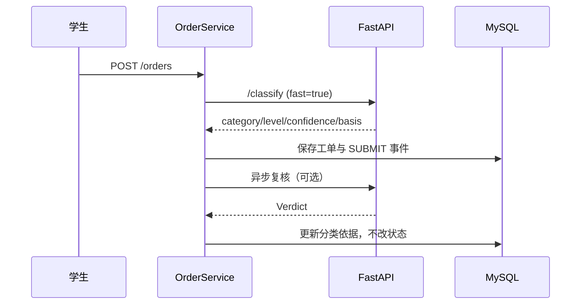

# AI 功能开发计划

| 项 | 内容 |
|---|---|
| 文档编号 | DPLAN-05 |
| 版本 | V1.2 |
| 状态 | ✅ 已完成（2026-11-18 验收回填） |
| 上游依据 | `06-AI功能开发.md`、`07-AI结果与工单落库.md` |

## 一、任务

1. AI 服务目标端口从 8000 迁移到 8001，后端 `AI_SERVICE_URL` 同步。
2. 保留 `/health`、`/classify`、`/rules`、`/warmup` 契约。
3. 校验规则定级、LLM 复核、JSON 重试和失败兜底。
4. 确保提交链路使用 `fast=true` 规则路径，不等待慢模型。
5. 确保 `Verdict` 映射到工单字段，不改变状态机。
6. 补充 AI 结果落库与复核日志测试。

> 关联任务：T07（端口）和 T11（AI 联调）。审计事件属于后端状态机改造，不得由 AI 服务推进。

## 二、开发顺序

| 顺序 | 工作 | 出口 |
|---:|---|---|
| 1 | 端口与环境变量迁移 | `/health` 在 8001 可达 |
| 2 | 规则单测回归 | 安全、浸水、低置信度通过 |
| 3 | 模型输出校验 | 非 JSON/非法类别回退 |
| 4 | Java 快速定级 | AI 断开仍能建单 |
| 5 | Java 异步复核 | 只更新分类字段，不改状态 |
| 6 | 工单字段映射测试 | category/level/levelSource/aiBasis 一致 |

## 三、AI → 工单链路

## 四、验收

- AI 服务停止时，建单仍成功并进入 `PENDING`。
- 安全关键词始终优先于模型输出。
- 复核失败不覆盖快速定级。
- 日志包含来源、耗时和 fallback 原因，不打印密钥。
- `confidence` 当前不独立入库的事实必须在文档中保持明确；后续加列时同步 API 和数据库设计。
